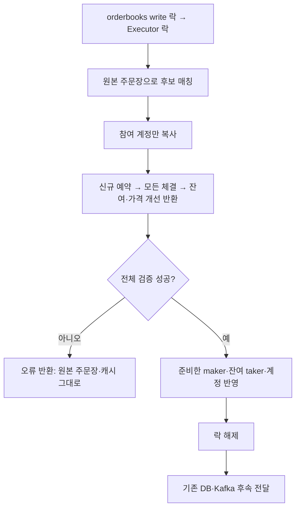

# 한 신규 주문의 매칭과 잔액을 메모리에 함께 확정하기

한 주문이 여러 상대 주문과 체결될 때, 마지막 정산 실패로 앞 체결과 주문장이 부분 반영되는 문제를 해결한다. 원본을 읽어 후보를 만들고 예약·전체 정산·잔여 반환까지 검증한 뒤, 두 락을 유지하며 주문장과 실행 캐시에 함께 반영한다. **DB·Kafka까지 포함하는 영속 거래 확정은 아직 아니다.**

## 문제와 재현

기존 Matcher는 원본 주문장에서 상대 주문을 먼저 빼고 잔량을 바꿨다. Executor는 체결을 순서대로 실행했다. 두 번째 상대의 예약금이 부족하면 첫 번째 체결의 잔액은 남고, 두 상대 주문은 이미 주문장에서 사라질 수 있었다. 앞서 구현한 단일 체결 원자성만으로 여러 체결을 묶지는 못했다.

새 `submission_second_fill_failure_preserves_entire_book_and_cache` 테스트에서 두 상대 중 두 번째 예약만 손상시켰다. 수정 전에는 주문장의 매수 큐가 사라져 실패했다. 수정 후에는 매수·매도 × 지정가·시장가 네 경로 모두 실패 전 주문·FIFO·잔량·카운터·전체 캐시가 보존된다. 검증 실패 전에 DB 명령도 발행하지 않는다.

기존 Matcher는 같은 고객의 주문을 큐 뒤로 돌렸다. 해당 고객 주문만 있으면 외부 반복문이 끝나지 않거나, 이미 꺼낸 주문이 사라질 수 있었다. 이제 불변 순회에서 같은 고객을 건너뛰어 유한하게 끝나고 기존 위치를 보존한다. 완전한 자기 체결 방지 정책은 아래 한계에서 구분한다.

## 기존 제품과 공식 자료

- [Coinbase 매칭 엔진](https://docs.cdp.coinbase.com/exchange/concepts/matching-engine): 가격·도착 순서 우선, maker 가격 체결, 동일 고객 비체결을 확인했다. 공개 자료가 설명하지 않는 내부 트랜잭션 구현은 추측하지 않는다.
- [TigerBeetle linked events](https://docs.tigerbeetle.com/coding/linked-events/): 연결한 금융 변경을 전부 성공하거나 전부 실패하게 처리한다. 이번 적용은 메모리 상태의 오류 경계이며 TigerBeetle 수준의 영속성·복제 보장을 뜻하지 않는다.
- [Binance 필터](https://developers.binance.com/en/docs/products/spot/filters): 거래소는 가격·수량 단위를 명시적으로 제한한다. 현재 프로젝트의 고정 NUMERIC(30,9) 계약 안에서 정확한 수량·대금을 계산하며, 자산별 LOT_SIZE/MARKET_LOT_SIZE 전체를 도입했다고 표시하지 않는다.

## 선택과 트레이드오프

| 선택 | 이점 | 비용·제약 |
|---|---|---|
| 불변 주문장으로 후보 계산 | 뒤 정산 실패에도 주문·우선순위가 원본에 남음 | 체결 후보와 변경 maker를 별도로 보관 |
| 참여 계정만 작업 공간에 복사 | 고객·자산 전체 캐시 복제 불필요 | 참여 계정 수만큼 Map·문자열 할당 |
| orderbooks → Executor 락을 계산부터 확정까지 유지 | 공통 자산의 경쟁 쓰기·중간 상태 조회 차단 | 큰 주문은 다른 마켓과 조회를 오래 막을 수 있음 |
| 전체 예약·정산·반환을 미리 검사 | 뒤 체결·반환 실패도 원본 변경 없이 거부 | 한 체결만 유효해도 주문 전체 후보는 실패할 수 있음 |
| 벤치와 제품이 같은 함수 사용 | 오류를 무시하던 벤치 분기 제거 | 이전 벤치 수치와 직접 성능 비교할 수 없음 |

전체 주문장·잔액을 복제하는 대안은 고객·호가 수에 비례한 비용이 든다. 사후 역이체·주문 재삽입은 복구 중 실패와 FIFO 복원 문제를 늘린다. 준비한 변경만 적용하는 방식을 선택했다. 성능 개선 수치는 측정하지 않았다.

후보 계산은 검토한 호가를 순회하고, 변경 maker와 참여 계정을 저장한다. 확정 시에는 마지막 변경 maker까지의 큐 앞부분만 처리한다. 건너뛴 자기 주문·부분 체결 주문을 작은 prefix로 옮겼다가 같은 순서로 되돌려, 긴 미체결 꼬리를 복제·전수 순회하지 않는다. 새 설정·호환 경로는 추가하지 않았다.

## 구현 흐름



- [matcher.rs](../../src/domains/cex/engine/matcher.rs): `plan_order(&OrderEntry, &OrderBook)`가 다음 taker·변경 maker·체결 목록·정확한 누적 대금을 계산한다. 기존 원본 수정형 `match_order`를 삭제했다. 잘못된 주문 종류·누락 가격·손상 잔량·다른 마켓 maker도 오류로 반환한다.
- [submission.rs](../../src/domains/cex/engine/runtime/submission.rs): 후보 전체를 준비하고 확정하는 공통 함수다. 새 마켓도 검증 성공 뒤에만 생성한다. 실패한 명령은 원본에 예약이나 0 잔액 행을 남기지 않는다.
- [orderbook.rs](../../src/domains/cex/engine/orderbook.rs): 준비한 maker만 제자리 변경·제거하고 주문 수 카운터를 조정한다. 잔여 지정가는 FIFO 뒤에 등록한다.
- [balance_cache.rs](../../src/domains/cex/engine/balance_cache.rs): 참여 계정 복사·전체 준비 값 적용을 제공한다. 단독 lock/unlock도 두 결과를 먼저 검사해 부분 변경·panic을 피한다.
- [amount.rs](../../src/domains/cex/engine/amount.rs): 기존 정확한 금액 검사를 공유하고 덧셈·뺄셈·대금·시장가 수량을 같은 계약으로 계산한다. 설치된 BigInt를 사용하며 의존성 추가는 없다.
- [threads.rs](../../src/domains/cex/engine/runtime/threads.rs), [bench_engine.rs](../../src/domains/cex/engine/runtime/bench_engine.rs): 같은 준비·확정 함수를 호출한다. 중복 캐시 체결·예약 해제와 실패 체결 무시 분기를 삭제했다. 후속 주문 상태 명령에는 이미 검증한 누적 수치를 쓴다.
- [executor.rs](../../src/domains/cex/engine/executor.rs): 캐시 소유자로 단순화했다. 단일 체결 즉시 실행 API·skip_db_updates·ExecutionResult·사용하지 않는 DB/WAL 채널·주석 처리된 발행 코드와 근거 없는 성능 설명을 삭제했다. 채널 생명주기는 런타임이 관리한다.

## 예약과 금액 계산

신규 지정가 매수의 예약은 `limit price × 전체 수량`이다. 체결 후에는 `limit price × 남은 수량`만 예약으로 남긴다. 나머지에서 실제 사용 대금을 빼 가격 개선 금액을 반환한다. 완전 체결뿐 아니라 부분 체결도 반환한다.

예: 4 SOL을 100 USDT에 매수해 400을 예약하고, 2 SOL을 90에 체결하면 실제 사용 180·잔여 예약 200·즉시 반환 20이다. 초기 1000이면 available 620, locked 200이다.

시장가 매수는 Decimal 나눗셈의 반올림을 쓰지 않는다. 1e-9 단위의 정수 예산 b, 가격 p, 수량 a에서 대금 단위는 `p × a / 1e9`다. a는 상대 잔량·예산 이하여야 하고, 대금도 정수 단위여야 한다. 따라서 `1e9 / gcd(p,1e9)`의 배수 중 최대 a를 선택한다. gcd는 작은 정수에 대한 유클리드 알고리즘이며, 큰 중간 곱은 기존 BigInt가 계산한다.

예산 1, 가격 3이면 수량 0.333333333·대금 0.999999999를 체결하고 0.000000001을 반환한다. 예산 1, 가격 0.3이면 두 값이 모두 정확한 수량 3.333333330을 선택한다. 고객이 지정한 수량을 임의 반올림하는 방식은 아니며, 예산 기반 주문의 실행 수량을 결정하는 현재 저장 계약이다. 자산별 최소 주문량·수수료는 후속 범위다.

## Rust 문법과 동시성

`&OrderBook`은 원본을 읽는 참조다. 후보 함수가 원본 주문을 꺼내거나 수정하지 못하도록 타입이 제한한다. `MatchPlan`이 수정된 다음 상태를 소유하고, `commit_book`에서만 반영한다. TypeScript의 별도 다음 상태 객체와 비슷하지만 Rust는 읽기 참조의 변경을 컴파일 단계에서 제한한다.

`?`로 반환하는 금액 오류는 모두 확정 전에 끝난다. 확정 구간에는 금액 연산·DB·채널·await가 없다. 동시에 잡은 두 락이 외부 관찰을 막는다. `std::mem::take`는 준비한 maker 목록의 소유권을 옮기며 전체 원본을 복제하지 않는다. commit 중 내부 expect는 같은 write 락 아래에서 계획한 maker가 그대로 있다는 불변조건에 의존한다.

## 작성·갱신한 테스트

[settlement_pipeline_tests.rs](../../src/domains/cex/engine/runtime/engine/settlement_pipeline_tests.rs)에 다음 **12개**를 추가했다.

| 신규 함수 | 시나리오·기대 결과 |
|---|---|
| submission_second_fill_failure_preserves_entire_book_and_cache | 네 주문 경로에서 두 번째 체결 실패, 전체 주문장·캐시·FIFO·카운터 보존·DB 명령 없음 |
| submission_reservation_failure_creates_neither_market_nor_zero_balance | 잔액 없는 주문, 마켓·0 행 생성 없음 |
| submission_price_time_priority_and_partial_maker_counters_are_preserved | 같은 가격 FIFO와 여러 가격 순서, maker 부분 잔량·카운터 |
| submission_partial_limit_buy_refunds_improvement_and_keeps_only_remaining_reservation | 부분 매수 가격 개선 반환·잔여 예약·후속 체결 |
| submission_market_budget_uses_exact_quantity_and_returns_dust | 정수·소수 가격의 예산 수량과 잔돈 정확성 |
| submission_no_liquidity_market_orders_return_entire_reservation | 매수·매도 IOC 유동성 없음, 전체 예약 반환 |
| submission_self_orders_do_not_rotate_or_disappear | 같은 고객 maker를 건너뛰어도 기존 FIFO 보존 |
| submission_only_self_liquidity_finishes_without_mutation_or_infinite_loop | 자기 유동성만 있는 시장가 두 방향, 유한 종료·원본 보존 |
| submission_refund_precision_failure_preserves_book_and_entire_cache | 마지막 반환 금액 표현 불가, 앞 정산도 반영 없음·DB 명령 없음 |
| submission_benchmark_uses_same_core_and_failure_boundary | 제품·벤치 체결 결과 동일, 실패 반환 |
| submission_invalid_candidate_returns_error_without_panic_or_state_change | 누락 가격·범위 초과·잘못된 유형·잔량 손상, panic·변경 없음 |
| submission_candidate_planning_never_mutates_original_orderbook | 후보 생성만으로 입력·원본 주문장 변경 없음 |

기존 `settlement_failure_aborts_success_followups_for_limit_and_market`는 새 경계에 맞춰 캐시 신규 예약도 반영되지 않는지 검사한다. 플랫폼 DB 예약을 해제한다는 뜻은 아니다.

[캐시 테스트](../../src/domains/cex/engine/balance_cache/settlement_tests.rs) 21건은 삭제된 Executor 단일 체결 API 대신 실제 캐시 정산을 검사하도록 옮겼다. `successful_trade_moves_both_assets`로 이름을 갱신했고, 삭제한 DB 전달 플래그 검사는 `reservation_result_precision_failure_preserves_cache`로 교체했다. DB 명령을 발행하지 않는지는 위 실제 호출부 실패 테스트가 검사한다.

## 실행과 결과

```bash
# .cargo/bin이 PATH에 없으면 절대 경로 cargo를 사용한다.
python3 scripts/verify_order_safety.py
cargo check --locked --benches --features bench_mode
JAVA_HOME=/Library/Java/JavaVirtualMachines/temurin-21.jdk/Contents/Home \
PATH=/usr/local/bin:$PATH python3 scripts/verify_durable_acceptance.py
```

- 수정 전 신규 핵심 재현 1건 실패: 두 번째 체결 정산 실패 뒤 원본 주문장 유실 확인.
- 최종 Rust 선택 테스트 **82건 통과, 실패·ignored 0**: 요청 3, 주문 저장소 2, 캐시 정산·파이프라인 35, 접수 18, 시작 18, 예약 1, 라우터 5. 필터 밖 테스트는 실행하지 않았다.
- `cargo test --locked --no-run` 전체 테스트 컴파일·`cargo build --locked` 바이너리 빌드 성공. 기존 unused/dead-code 및 Solana/SQLx future incompatibility 경고가 남는다.
- `cargo check --locked --benches --features bench_mode` 성공. 벤치 대상의 컴파일만 확인했고 처리량·지연 측정은 실행하지 않았다.
- 실제 Java↔Rust↔임시 PostgreSQL 접수 회귀 **3개 시나리오 통과**: 응답 유실·중복 재전송 차단, 정상 접수 응답 검증, 미복구 접수 재시작 차단. 이 프로세스 검증은 상대 주문 없는 접수이며 주문장·전체 정산 검증은 위 실제 인메모리 파이프라인 테스트가 담당한다. DB 정산·Kafka E2E까지 확인했다고 해석하지 않는다.
- PostgreSQL 테스트는 전용 임시 postgres:16 서버에서 실행하고 컨테이너를 제거했다. 공유 고객 DB·다른 프로젝트 5432는 사용하지 않았다. 기존 개발 서버는 교체하지 않고 봇 0을 유지했다. Java 코드는 이번에 변경하지 않아 Java 단위 테스트는 재실행하지 않았다.
- 공통 루트 `.local/submission-before.log`, `submission-expanded-tests.log`, `submission-rust-*.log`, `submission-rust-results.json`, `submission-bench-check.log`, `submission-durable-process.log`에 증거를 남겼다. 컴파일 중 테스트 fixture의 옛 생성자 호출 4곳을 수정하고 전체 선택 테스트를 다시 실행했다.

## 보장 범위와 후속 과제

1. **일반적인 Result 오류에서 한 신규 주문의 메모리 변경 전체를 보존한다.** 주문장·실행 예약·모든 체결·반환을 묶었다. 원본을 수정한 뒤 되돌리는 방식이 아니다.
2. 프로세스 종료·OOM·호스트 손실의 내구성, 영속 접수 순서·재생, 단일 처리자 펜싱은 미완료다. 영속 접수 후 실행 실패 시 접수와 플랫폼 DB 예약은 유지되며 자동 재전송·보정하지 않는다.
3. DB Writer·Java Kafka Consumer의 확정 책임·중복 처리·수수료·이벤트 순서와 outbox는 여전히 미완료다. 후속 전달 오류가 메모리 확정을 되돌리지 않는다. 기존 이벤트 스냅샷과 실제 DB 정산까지 일관된 결과임을 주장하지 않는다.
4. 같은 고객끼리 체결하지 않는 기존 조건만 보존했다. Coinbase의 cancel-newest/decrement-cancel 같은 STP 종료 정책을 구현한 것은 아니다. 자기 주문 건너뛰기로 교차 잔여 지정가가 생길 수 있는 정책 한계는 별도로 해결해야 한다.
5. 이번 후보·확정은 신규 주문 경로다. 기존 취소 명령의 주문장 제거·예약 해제·DB 상태 확정도 같은 방식으로 검증해야 한다. H2 전체 완료로 표시하지 않는다.

## 관련 커밋

`a33f798`: 후보 매칭·전체 메모리 확정·정확한 예산 수량·벤치 공통화·사용하지 않는 실행 경로 삭제와 테스트. 하나의 실행 경계를 교체하므로 구현과 해당 회귀 테스트를 함께 커밋했다.

선행: [단일 체결 캐시 원자성](004-atomic-trade-cache-settlement.md), [금액 경계 재검토](005-exact-amount-boundaries-review.md). 이번 변경은 전자의 주문장·여러 체결 한계를 메모리 경계에서 확장한다.
