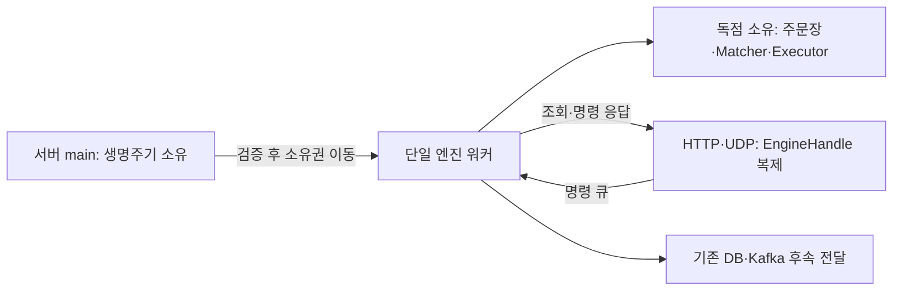

# 엔진 상태를 단일 워커가 독점 소유하도록 바꾸기

주문장과 실행 잔액의 공유 락, 요청 전체를 감싸던 비동기 락을 제거했다. 서버는 시작·종료를 관리하고, 요청 서비스는 명령 핸들로 워커와 통신한다. 금액 정확성과 신규 주문의 실패 시 원본 보존은 유지한다.

## 문제와 기존 동작

단일 엔진 스레드를 사용하면서도 주문장은 `Arc<RwLock<...>>`, Executor는 `Arc<Mutex<...>>`로 공유했다. 최근 신규 주문 원자성 구현에서는 후보 계산부터 확정까지 두 락을 유지했다. 정합성은 개선했지만 상태를 독점 소유해 락 비용을 없앤다는 엔진 설계 의도에 어긋났다.

HTTP·UDP도 `Arc<tokio::sync::Mutex<HighPerformanceEngine>>`를 공유했다. 조회가 응답을 기다리는 동안 다른 요청의 큐 진입까지 직렬화될 수 있었다. 취소·조회·잔고 명령의 blocking send는 큐가 가득 차면 응답 timeout 전에 호출 스레드를 막을 수 있었다.

## 기존 제품과 공식 자료의 접근

- [exchange-core](https://github.com/exchange-core/exchange-core#features)는 메모리 상태, 락 없이 처리하는 매칭·위험 검사, 결정적인 원자 연산, 단계별 파이프라인을 설명한다. 이번에는 상태 소유자와 명령 전달을 분리하는 원칙을 참고했다. 해당 프로젝트의 다중 코어·샤딩 구조나 성능 수치를 그대로 적용하지 않았다.
- [Rust 공식 메시지 전달 설명](https://doc.rust-lang.org/book/ch16-02-message-passing.html)은 소유권을 이동시키고 채널로 통신하는 방식을 설명한다. Rust의 소유권으로 외부의 가변 상태 접근을 제한할 수 있다.
- 설치된 crossbeam-channel 0.5.15의 bounded 구현과 API 설명을 확인했다. 기존 crossbeam과 Tokio oneshot으로 구현할 수 있어 의존성을 추가하지 않았다. 소스에서 참조가 사라진 parking_lot 직접 의존성은 제거했다. 하위 의존성이 사용하는 같은 패키지까지 임의로 삭제하지 않는다. bounded 채널 사용 자체가 전체 엔진의 비차단 실행을 보장하지는 않는다.

## 선택과 트레이드오프

| 선택 | 이점 | 비용·제약 |
|---|---|---|
| 거래 상태를 시작 시 워커로 이동 | 상태 공유와 주문장·잔액 락 제거 | 외부 직접 조회·수정 불가, 명령으로 접근 |
| 제어 객체와 복제 가능한 명령 핸들 분리 | 요청 대기 중 다른 요청 진입 가능 | 시작·종료는 서버 소유 객체로만 수행 |
| 모든 입력에 `try_send` 사용 | 큐 포화 시 호출 스레드를 막지 않음 | 즉시 오류를 처리해야 하며 무제한 버퍼링하지 않음 |
| 기존 단일 명령의 준비·확정 유지 | 금액·원본 보존 회귀 유지 | 준비 공간·문자열·BigInt 비용은 아직 남음 |
| 출력 경로의 계약은 후속 작업으로 명시 | 소유권 변경과 금융 기록 변경을 구분해 검증 | DB 출력 대기·체결별 Kafka 스레드는 이번에 해결되지 않음 |

락을 더 짧게 잡거나 락 종류만 바꾸는 대안은 상태 공유를 유지한다. 요청별로 별도의 엔진을 만들면 서로 다른 주문장·잔액이 생긴다. 하나의 거래 상태를 워커에 이동시키는 방식을 선택했다. 예전 공유 객체 API를 유지하는 호환 래퍼는 만들지 않았다.

## 구현과 관련 코드



- [engine.rs](../../src/domains/cex/engine/runtime/engine.rs): 상태를 `Option<EngineState>`로 보유하다 시작 시 `take()`로 이동한다. 시작 후 제어 객체의 state는 None이다. DB 초기 상태 검증은 이동 전에 수행한다. 시작 실패·중복 시작·정지 인스턴스 재사용 차단은 유지했다.
- [handle.rs](../../src/domains/cex/engine/runtime/handle.rs): 송신 채널과 닫힘 표식만 가진다. clone으로 거래 상태나 생명주기 권한을 복제하지 않는다. 신규 주문·취소·조회·예약·예약 해제·잔고 동기화 입력은 모두 `try_send`를 사용한다.
- [threads.rs](../../src/domains/cex/engine/runtime/threads.rs): 주문장·Matcher·Executor를 값으로 받아 소유한다. 명령 처리 함수에는 가변 참조를 대여한다. 사용하지 않던 Database 인자도 워커에서 제거했다.
- [submission.rs](../../src/domains/cex/engine/runtime/submission.rs), [matcher.rs](../../src/domains/cex/engine/matcher.rs): 준비·검증·확정 알고리즘은 유지하고 락을 전제로 한 설명을 독점 대여로 바로잡았다.
- [Engine 인터페이스](../../src/domains/cex/engine/mod.rs): 명령만 정의한다. 시작·종료는 HighPerformanceEngine의 생명주기 API에 남기고 Mock의 사용하지 않는 시작·종료 구현을 삭제했다.
- [AppState](../../src/shared/services/app_state.rs), [main](../../src/main.rs), CEX 서비스·잔고 핸들러·UDP 피드: 명령 핸들을 주입한다. 서버 main이 제어 객체를 소유한다.
- 벤치 전용 상태 조작은 워커를 시작하기 전에만 가능하다. 실행 중에는 상태가 없으므로 직접 수정할 수 없다. 벤치 모드 시작은 테스트에서 준비한 잔액을 보존한다. 표준 모드는 검증된 DB 스냅샷을 사용한다.

## 이해에 필요한 문법과 원리

- `move` 클로저는 주문장·실행 캐시의 소유권을 스레드로 넘긴다. 같은 객체를 여러 스레드가 공유하는 `Arc`와 다르다.
- `Option::take()`는 Some 안의 값을 꺼내고 None을 남긴다. 시작 후 외부에서 같은 상태를 다시 빌릴 경로가 없다.
- `&mut`는 대여 중 중복 접근을 컴파일러가 제한한다. 워커가 명령을 하나씩 처리하므로 주문 전체 준비·확정 사이에 다른 명령이 끼어들지 않는다. 자바스크립트의 이벤트 루프와 비교할 수 있지만 Rust는 소유권·대여까지 검사한다.
- 핸들의 `Clone`은 송신 채널과 닫힘 표식을 복제한다. 주문장·잔액을 복사하거나 참조로 노출하지 않는다.
- 종료 표식의 AtomicBool은 거래 상태를 보호하는 락이 아니다. 기존 핸들로 정지 후 명령을 보내는 것을 거부하는 생명주기 표식이다.
- `try_send` 성공은 큐 진입이다. 매칭 성공이나 디스크 영속 확정을 의미하지 않는다. 조회·취소 등의 응답 timeout도 이미 큐에 들어간 명령을 자동으로 취소하지 않는다.

### 현재 코드로 연결해 읽기

HTTP 쪽에 제공하는 핸들은 송신 채널과 종료 신호만 갖는다. 아래는 2026-10-23 현재 [실제 소스](../../src/domains/cex/engine/runtime/handle.rs#L20)의 연속 행 발췌다. 메서드 일부일 수 있으므로 독립 실행 예제로 사용하지 않고 앞뒤 검증과 함께 읽는다. 과거 사이클의 코드/측정 시점은 본문의 기록을 유지한다.

```rust
pub struct EngineHandle {
    pub(super) order_tx: Sender<OrderCommand>,
    pub(super) balance_tx: Sender<BalanceCommand>,
    pub(super) closed: Arc<AtomicBool>,
}
```

채널 Sender의 clone은 명령 제출 권한을 복제한다. `Arc<AtomicBool>`은 수명/종료 신호이며 오더북·잔액을 공유 락으로 감싼 상태가 아니다. 실제 거래 상태는 한 워커가 소유한다.

## 작성·수정한 테스트

### 신규 테스트

| 파일·함수 | 검증 시나리오와 기대 결과 |
|---|---|
| [ownership_tests.rs](../../src/domains/cex/engine/runtime/engine/ownership_tests.rs) `ownership_worker_moves_state_and_matches_direct_core_results` | 시작 후 제어 객체 상태가 None, 실제 워커에서 여러 maker 체결 후 잔량·모든 참여 잔액이 순수 계산 결과와 일치, 정지 후 기존 핸들 거부 |
| 같은 파일 `ownership_worker_failure_preserves_orderbook_and_balance` | 실제 워커에서 잔액 부족 주문 처리 후 주문장·잔액 보존 |
| [handle.rs](../../src/domains/cex/engine/runtime/handle.rs) `ownership_handle_queries_enter_queue_without_waiting_for_other_reply` | 첫 응답 전 두 조회 모두 큐 진입, 역순 응답도 올바른 요청으로 전달 |
| 같은 파일 `ownership_handle_all_inputs_reject_full_queues_without_blocking` | 주문·취소·조회·예약·예약 해제·동기화 입력이 가득 찬 큐에서 오류 반환, 제한 시간 후 수신자 해제로 회귀 시 테스트 스레드 회수 |
| 같은 파일 `ownership_handle_rejects_closed_and_disconnected_channels` | 닫힌 표식 또는 수신자 소멸 시 즉시 오류 |

### 기존 회귀 변경

- 정산 파이프라인·예약 테스트의 공유 락 기반 주입을 시작 전 상태의 독점 대여로 변경했다. 검증하는 금액·FIFO·실패 시 보존 조건은 유지했다.
- 시작 검증에서 실행 중 캐시를 직접 수정하던 조작을 명령 큐의 잔액 예약으로 바꿨다.
- 접수·라우트·UDP·기존 통합 테스트의 호출을 새 핸들 API에 맞췄다. 기존 공유 DB 의존 통합 테스트는 컴파일만 확인한다.
- [검증 실행기](../../scripts/verify_order_safety.py)에 신규 ownership 테스트를 포함했다.

## 실행 명령과 결과

2026-10-21 로컬에서 다음 명령으로 확인했다. PostgreSQL 회귀는 실행기가 생성한 별도 서버 컨테이너만 사용하며 기존 5432·5433 DB를 수정하지 않는다.

```sh
python3 scripts/verify_order_safety.py
cargo check --locked --benches --features bench_mode
python3 scripts/verify_durable_acceptance.py
```

- 선택한 Rust 테스트 **87건 통과**: 소유권 5, 요청 3, 저장소 2, 정산 35, 접수 18, 시작 검증 18, 예약 1, 라우트 5. 각 선택 실행에서 실패·무시 0건이다. 전체 테스트 실행 결과는 아니다.
- 전체 테스트 컴파일과 엔진 바이너리 빌드 성공.
- 벤치 대상 컴파일 성공. 처리량·지연 측정은 실행하지 않았다.
- 실제 Java↔Rust↔임시 PostgreSQL 검증 **3개 시나리오 통과**: 응답 유실 후 같은 주문의 엔진 처리 1회, 정상 접수 응답 검증, 미복구 접수의 재시작 차단. 상대 주문 없는 접수 검증이며 Kafka 정산 전체를 시험한 결과는 아니다.
- 기존 unused/dead-code 및 Solana·SQLx의 향후 호환성 경고는 남는다.
- 증거: 공통 루트 `.local/review-rust-results.json`, `.local/review-rust-ownership.log`, `.local/ownership-bench-check.log`, `.local/durable-acceptance-process.json`.
- 기존 개발 서버·사용자 DB·봇 설정은 변경하지 않았다. 봇을 비활성화한 임시 프로세스로 검증했다.

과거 벤치마크 수치를 이번 코드의 성능 보장으로 사용하지 않는다.

## 출력 워커 후속 수정

[008 출력 워커 분리](008-ordered-output-worker.md)에서 아래에 남겼던 DB 출력 send·체결별 스레드·런타임·핵심 경로의 상세 로그를 제거했다. 시작·접수 등 필요한 DB 접근은 유지한다. 007의 테스트 수치는 당시 기록이며 후속 검증 결과는 008에서 확인한다.

## 남은 한계와 다음 작업

- 이번 변경은 거래 상태와 요청 경로의 공유 락 제거다. crossbeam 내부 구현·Kafka·DB까지 포함해 전체 시스템이 형식적 의미의 lock-free라고 주장하지 않는다.
- 출력 워커 분리와 포화·실패 처리의 후속 결과는 008에 기록했다. WAL 내구성·출력 재생은 미완료다.
- WAL 기록·재생, DB 접수와 실행 결과 연결, Rust·Java 주문 상태 이중 쓰기, 잔액 스냅샷·수수료 충돌은 미완료다.
- 취소 실패 시 원본 보존·카운터, 잔고 동기화 멱등성·음수 보정, 두 입력 큐의 재생 순서·공정성도 남는다.
- 현재 stop은 남은 입력 큐를 비우거나 출력 확정 위치를 보존하지 않는다. 종료와 요청 전송이 경쟁하는 경우까지 접수·복구를 보장하지 않는다.
- 처리량·지연 분포·할당량 측정은 실행하지 않았다. 코어 고정·배포 자원 격리·호스트 장애 복구도 이번 검증 범위가 아니다.

## 관련 기록

- 구현·테스트 커밋: `097ce20` — 거래 상태의 워커 이동, 명령 핸들 분리, 입력 큐 포화 처리와 회귀 테스트.

- 선행: [신규 주문 메모리 확정](006-atomic-order-memory-commit.md).
- 진단: [엔진 설계 의도와 현재 구현의 차이](../../../docs/reviews/2026-10-21-engine-design-identity-audit.md).
- 공통 작업 규칙에 엔진 독점 소유·락 제거 원칙과 한글 주석 규칙을 추가했다.
