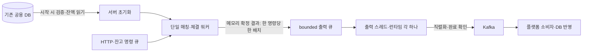

# 체결 결과를 하나의 출력 워커로 분리하기

> 후속 변경: [009 WAL 확정과 복구](009-durable-journal-recovery.md)에서 자체 저널 재생을 연결했다. 아래 내용은 해당 결정 당시의 상태다. DB 시작 차단은 이제 새 저널의 최초 기동에 적용하고, 기존 저널이 있으면 자체 기록으로 복원한다.

단일 엔진 워커는 주문장과 실행 잔액을 메모리에서 변경하고, 확정 결과를 하나의 출력 큐로 넘긴다. 별도 워커가 Kafka 직렬화·발행·완료 확인을 담당한다. 체결별 스레드·런타임 생성, 핵심 경로의 DB 채널 전송과 상세 로그를 제거했다.

## 문제와 기존 동작

- 체결·취소마다 OS 스레드와 Tokio 런타임을 만들었다. 발행 순서는 스케줄링에 따라 달라질 수 있었다.
- bounded DB 채널의 `send`가 가득 찬 큐에서 엔진을 막았다.
- Rust DB Writer가 주문을 filled로 먼저 저장하면 Java 소비자가 정상 체결을 중복으로 판단해 건너뛸 수 있었다. 취소 서비스의 DB 상태 선반영도 같은 책임 충돌이 있었다.
- Kafka 전달 오류·시간 초과를 `Ok(())`로 바꿔 실패를 숨겼다.
- 저장 워커와 채널은 남아 있었지만 WAL 명령은 실제 경로에서 발행되지 않았다.

## 기존 제품과 공식 자료의 접근

[LMAX Disruptor 공식 가이드](https://lmax-exchange.github.io/disruptor/user-guide/index.html)는 소비자의 진행 위치로 생산자가 소비자를 추월하지 않게 제어하는 방식을 설명한다. 유한 버퍼에서 느린 소비자의 데이터를 덮어쓰지 않으려면 진행 제어가 필요하다. 이번에는 기존 crossbeam 채널을 유지하면서 한 생산자·한 명령당 한 배치라는 조건으로 적용했다.

[crossbeam-channel 0.5.15의 try_send](https://docs.rs/crossbeam-channel/0.5.15/crossbeam_channel/struct.Sender.html#method.try_send)는 즉시 성공하거나 원래 메시지를 포함한 오류를 반환한다. `try_send`만 호출하고 오류를 무시하면 확정 결과를 유실한다. 설치된 API와 구현을 확인했으며 새 채널 라이브러리는 추가하지 않았다.

## 선택과 트레이드오프

| 선택 | 이점 | 비용·제약 |
|---|---|---|
| 한 명령의 여러 체결을 한 출력 배치로 이동 | 체결 중간에 큐가 차서 일부만 넘기는 문제 제거 | 배치마다 체결 수에 따른 메모리가 필요 |
| 유일한 생산자가 빈 공간 확인 후 명령 처리 | 외부 입출력을 기다리는 blocking send 제거 | 출력이 밀리면 입력 처리도 제한됨 |
| 출력 포화 시 입력을 큐에 유지 | 확정 결과를 버리거나 무제한 버퍼링하지 않음 | 뒤 명령·조회가 기다리고, 바쁜 반복은 CPU를 사용 |
| 수명이 긴 출력 스레드와 런타임 각각 하나 | 체결별 생성 비용 제거, 발행 확인을 순서대로 처리 | 출력 워커가 처리량을 제한할 수 있음 |
| 발행 실패 시 신규 실행 차단 | 실패를 성공으로 숨기지 않음 | 자동 재전송하지 않으며 별도 복구가 필요 |
| 플랫폼 상태를 엔진이 선반영하지 않음 | Rust와 Java의 주문 상태 중복 갱신 제거 | 플랫폼 상태 반영은 이벤트 소비 완료까지 지연됨 |

출력을 무제한 큐로 바꾸면 메모리 상한을 잃고, 가득 찬 큐에서 결과를 버리면 금융 상태와 이벤트가 갈라진다. 일정 시간 기다린 뒤 임의로 버리는 정책도 선택하지 않았다.

## 구현과 상태 경계



- [threads.rs](../../src/domains/cex/engine/runtime/threads.rs): 반복 처리 구간에서 DB·네트워크·디스크 호출, 스레드·런타임 생성, 상세 로그를 수행하지 않는다. 입력 대기와 응답용 oneshot 전송은 유지한다.
- [output.rs](../../src/domains/cex/engine/runtime/output.rs): 체결 자료의 소유권과 고정 크기 잔액 스냅샷을 받는다. Kafka 이벤트 문자열·시간·JSON은 출력 워커에서 구성한다. 기존 스냅샷이 한 주문 전체 확정 후 상태라는 계약은 유지했다.
- [engine.rs](../../src/domains/cex/engine/runtime/engine.rs): 출력 수신자를 보관해 워커 실패 뒤에도 큐가 살아 있게 한다. 실행 상태는 워커 소유이며 정지 후 제어 객체로 회수한다. 사용하지 않던 DB Writer·WAL 워커·채널과 DbCommand를 삭제했다.
- [producer.rs](../../src/shared/kafka/producer.rs): 전달 오류를 Err로 반환한다. 별도 100ms 시간 제한을 제거하고 클라이언트의 전달 제한 시간 5초를 따른다. `acks=all`, 생산자 멱등성을 사용한다. 이는 Java DB까지의 중복 처리를 해결하지 않는다.
- [order_service.rs](../../src/domains/cex/services/order_service.rs): 취소 결과를 반환하면서 플랫폼 주문 상태를 먼저 저장하던 코드를 제거했다. 취소에 필요한 기존 DB 조회는 유지했다.
- [health.rs](../../src/shared/handlers/health.rs): 출력 실패·정지로 명령 처리가 닫히면 503을 반환한다. 브로커 전체의 가용성을 미리 검사하는 기능은 아니다.
- [config.rs](../../src/domains/cex/engine/runtime/config.rs): 실제 사용하지 않는 WAL·DB Writer 코어 설정과 환경 분기를 삭제했다. 기존 엔진 코어 0·실시간 우선순위 요청은 Linux에서 유지한다. macOS에서는 적용하지 않는다.

### 출력 공간의 조건

출력 큐의 송신자는 엔진 워커 하나만 가진다. 제어 객체는 수신자만 보유한다. 빈 공간을 확인한 뒤 다른 생산자가 그 공간을 차지하지 않으며, 소비자는 공간을 늘리기만 한다. 한 명령이 한 큐 항목을 만들므로 명령 실행 중 포화가 발생하지 않는다. 이 조건이 깨지면 전송 실패를 무시하지 않고 불변조건 위반으로 처리한다.

큐는 100,000개 배치와 워커가 처리 중인 한 배치를 담는다. 배치 수의 상한이며 바이트 단위 메모리 예산은 아니다. 큰 주문의 체결 목록과 임시 계산 공간의 비용은 남는다.

### 실패·종료

전달 확인 실패 시 배치 전체와 다음 미확인 이벤트 위치를 워커 반환값에 보존하고, 뒤 배치는 큐에 남긴다. 닫힘 표식을 게시해 엔진과 요청 핸들이 새 실행을 중단한다. 실패와 동시에 진행 중이던 마지막 명령의 출력도 수신 큐에 보관된다.

`stop()`은 엔진을 먼저 회수해 유일한 출력 송신자를 닫고 출력 워커를 회수한다. 정상 출력은 큐를 비운다. 실패한 경우 오류를 반환하면서 실패 배치·잔여 큐·정지한 거래 상태를 제어 객체에 보관한다. 입력 큐의 모든 접수를 처리하는 종료 보장은 이번에 구현하지 않았다.

**이 보존은 살아 있는 프로세스의 메모리 보존이다. 프로세스 종료·호스트 손실·메모리 부족·패닉에서의 영속 복구 보장은 아니다.** WAL 입력·확정 위치·출력 재생은 별도 작업이다. 전달 오류는 브로커에 메시지가 도착한 뒤 확인만 유실된 경우도 있어 임의 재전송하지 않는다.

### DB 사용의 범위

기존 공용 `cex` DB 하나를 유지한다. 별도 엔진 DB를 만들지 않았다. 초기 상태 검증·잔액 읽기, HTTP 접수 기록, 취소 전 조회는 그대로다. 필요한 DB 사용은 초기화·복구 또는 I/O 계층에 둘 수 있다. 이번 삭제 대상은 플랫폼과 상태 갱신 책임이 충돌하던 쓰기와 동작하지 않던 워커였다.

## 이해에 필요한 Rust 문법

- 배치를 채널로 보내면 Vec·체결 자료의 소유권이 이동한다. 엔진과 출력 워커가 같은 가변 상태를 공유하지 않는다.
- 제어 객체가 복제하는 것은 Receiver다. 결과를 동시에 소비하는 용도로 쓰지 않고 수신 큐의 수명을 유지한다.
- `Drop`으로 닫힘 표식을 게시한다. 출력 워커의 반환·오류·패닉 경로에서 새 요청 실행을 닫기 위한 생명주기 처리다. 금융 상태를 잠그는 Mutex가 아니다.
- 출력 루프는 정적 타입의 전달 함수를 받는다. 테스트는 실패 대역을 넣고 제품은 Kafka 클라이언트를 호출한다. 실행 중 플러그인·정책 설정은 추가하지 않았다.

## 작성한 테스트

[output_tests.rs](../../src/domains/cex/engine/runtime/engine/output_tests.rs)에 실제 제품 엔진 루프를 사용하는 7개 회귀를 작성했다.

| 함수 | 검증 |
|---|---|
| `output_full_queue_preserves_command_and_trading_state` | 포화 시 입력·주문장·잔액 보존, 미전달 결과를 정상 종료로 오인하지 않음 |
| `output_capacity_release_resumes_without_losing_a_batch` | 공간 확보 후 순서대로 재개·출력 보존·예약 결과 |
| `output_worker_drains_in_fifo_order_on_one_thread` | 한 출력 스레드에서 FIFO 처리, stop 후 출력 큐 비움 |
| `output_delivery_failure_closes_input_and_retains_every_committed_batch` | 발행 실패 후 입구 차단, 확정한 명령 수와 보존 배치 수 일치 |
| `output_failure_preserves_next_event_and_does_not_consume_later_batches` | 실제 두 체결 배치의 부분 확인 실패 위치·원본·후속 배치 보존 |
| `output_cancel_failure_preserves_order_and_success_updates_counter` | 예약 해제 실패·권한 오류 시 주문 보존, 성공 시 카운터·잔액 변경 |
| `output_cancel_invalid_book_entry_is_rejected_before_unlock` | 호가와 주문 가격이 불일치하면 예약 해제 전 거부 |

추가 테스트:

- [producer.rs](../../src/shared/kafka/producer.rs) `output_kafka_delivery_failure_is_not_reported_as_success`: 사용하지 않는 루프백 포트에서 실제 클라이언트 전달 실패를 Err로 반환.
- [routes/tests.rs](../../src/routes/tests.rs) `output_failure_closed_handle_reports_unavailable_health`: 닫힌 엔진 핸들의 실제 HTTP 헬스체크 503.
- [verify_engine_output.py](../../scripts/verify_engine_output.py): 별도 PostgreSQL·Kafka·Rust 프로세스로 체결→취소 발행, 플랫폼 주문 상태 미갱신, 브로커 중단 후 503을 확인한다. 1개 파티션에서 관찰하며 다중 파티션 소비 순서를 검증한 것은 아니다.
- 기존 정합성 테스트의 DB 채널 인자·사용하지 않는 임시 WAL 경로를 제거했다. 돈·FIFO·원본 보존 검사는 유지한다. 명령 처리 개수 증거는 엔진의 동기 로그 대신 출력 워커의 완료 로그로 확인한다.

## 실행 명령과 결과

```sh
python3 scripts/verify_order_safety.py
cargo check --locked --benches --features bench_mode
python3 scripts/verify_durable_acceptance.py
python3 scripts/verify_engine_output.py
```

- 선택한 Rust 회귀는 **고유 96개, 중복 포함 97회 실행**해 전부 통과했다. 출력 9·소유권 5·요청 3·저장소 2·정산 35·접수 18·시작 검증 18·예약 1·라우트 6이며 새 헬스체크 테스트는 출력·라우트 선택에 한 번씩 포함된다. 실패·무시 0건이다.
- 전체 테스트 컴파일·바이너리 빌드·벤치 대상 컴파일 성공.
- 실제 Java↔Rust 접수 회귀 3개 시나리오 통과.
- 별도 PostgreSQL·Kafka·Rust 출력 검증 3개 시나리오 통과. 마지막 실행의 브로커 중단 후 503 관찰 시간은 약 5.137초였으며 지연 보장이나 벤치마크 수치로 사용하지 않는다.
- 최종 재실행 중 장애 차단 관찰의 15초 제한에 걸린 실행이 있었다. 클라이언트 전달 오류 로그를 확인하고 외부 프로세스 검증의 관찰 제한을 45초로 조정해 재실행했다. 제품의 전달 설정을 시험 통과를 위해 바꾸지 않았고, 실패를 최종 통과 건수에 포함하지 않는다.
- 기존 unused/dead-code 및 Solana·SQLx 향후 호환성 경고가 남는다. 처리량·지연 분포·할당량 측정은 실행하지 않았다.
- 증거: 공통 루트 `.local/review-rust-results.json`, `.local/review-rust-output.log`, `.local/output-bench-check.log`, `.local/durable-acceptance-process.json`, `.local/engine-output-process.json`.
- 기존 개발 서버·봇 설정·업무 DB 데이터는 수정하지 않았다. 임시 컨테이너와 프로세스는 실행기가 회수했다.

새 출력 검증 스크립트의 첫 실행은 DB 호스트 환경 변수 이름을 잘못 지정해 기본 주소에서 인증 실패로 종료됐다. 금융 데이터 쿼리·쓰기 전의 실패였으며, `DATABASE_HOST`로 수정한 뒤 이 실행 소유 컨테이너에서 재검증했다. 이 실패를 통과 결과로 포함하지 않는다.

## 남은 한계

- Kafka에 순서대로 발행해도 서로 다른 파티션의 Java 소비 완료 순서까지 보장하지 않는다.
- 이벤트의 영속 식별자·소비자 멱등성·스냅샷 버전·수수료·플랫폼 취소의 상태 선반영 문제는 남는다.
- 현재 WAL 원시 구현은 실행 경로에 연결되지 않았다. 접수 기록만으로 자동 재시작·재실행하지 않는다.
- 출력 포화 때 조회도 지연된다. 명령당 체결 수·바이트 단위 큐 예산과 반복 할당 최적화는 남는다.
- 정상 종료의 입력 처리 위치, 프로세스 신호 종료, 장애 후 출력 복구를 완료한 것으로 표시하지 않는다.
- 초기화의 DB 읽기는 유지하며, DB 구성·책임의 추가 결정은 이 구현과 구분해서 논의한다.

## 관련 기록

- 구현·테스트 커밋: `53ed345` — 단일 출력 워커, 포화·실패·종료 처리와 격리 Kafka 검증.

- 선행: [단일 워커의 상태 독점 소유](007-single-owner-engine-state.md).
- 진단: [엔진 설계 의도 검토](../../../docs/reviews/2026-10-21-engine-design-identity-audit.md).
