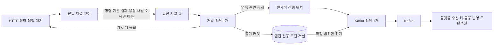

# 단일 체결 코어와 WAL 확정·복구 연결하기

**거래 처리는 빠르게, 복구는 느려도 안전하고 정확하게.** 체결 코어는 메모리 계산을 계속하고, 엔진 자체 저널의 영속 커밋이 확인된 결과만 응답과 Kafka에 공개한다. 재시작은 플랫폼 DB의 현재 잔액을 재해석하지 않고 자체 저널을 처음부터 검증·재생한다.

후속 [022 최초 기동 보완](022-first-bootstrap-current-history.md)은 현재 플랫폼 수신·입금 전송 이력도 확인해 새 경로를 최초 시작점으로 오인하지 못하게 한다. 기존 자체 저널 재시작은 계속 DB 없이 복원한다.

## 문제와 기존 동작

008까지는 단일 코어와 별도 Kafka 워커를 연결했지만 출력이 메모리에만 있었다. 프로세스 종료로 큐를 잃으면 엔진 상태와 플랫폼 반영이 갈라질 수 있었다. `engine/wal.rs`의 JSON 파일 구현도 서버에 연결되지 않아 실제 복구 근거가 아니었다.

플랫폼 DB의 접수 기록은 원본 검증과 요청 재확인에는 유용하지만, 미체결 주문의 FIFO·실행 잔액·취소·체결 순서를 복원하지 못한다. 접수 DB 커밋 뒤 큐 전달이 실패해도 성공으로 응답하던 계약도 강화해야 했다.

## 기존 제품과 의존성 검토

- [LMAX Disruptor 가이드](https://lmax-exchange.github.io/disruptor/user-guide/)의 소비자 의존성과 진행 순번을 참고했다. 저널·외부 전송·거래 계산을 분리하되 소비자가 영속 기록을 추월하지 않게 한다. Disruptor 라이브러리를 도입한 것은 아니다.
- [SQLite WAL](https://www.sqlite.org/wal.html)과 [synchronous 설정](https://www.sqlite.org/pragma.html#pragma_synchronous)의 커밋·동기화 계약을 사용한다. 직접 파일 프레임·부분 쓰기 복구·체크포인트를 구현하지 않는다.
- 기존 SQLx 0.6.3은 SQLite 기능을 제공한다. 설치된 Cargo 기능과 `sqlite/connection/worker.rs`를 확인했다. 현재는 PostgreSQL 기능만 활성화돼 있으며, SQLite 비동기 연결에는 별도 내부 워커가 사용된다.
- 전용 기록 스레드에서 동기 저장하는 현재 역할에는 [rusqlite 0.40.2](https://docs.rs/rusqlite/0.40.2/rusqlite/)를 선택했다. bundled SQLite 3.53.2를 함께 빌드한다. 새 DB 서버는 실행하지 않는다.
- 본문 검사는 SHA-256 원본 32바이트를 사용한다. 2026-10-25 [017번 기록](017-remove-retired-chain-integrations.md)에서 기존 SDK를 `sha2`로 대체했으며 기록 형식은 그대로다. 인증 서명이나 악의적인 관리자 변조에 대한 방어로 해석하지 않는다.

## 구조와 확정 경계



코어가 독점 소유하는 주문장·실행 잔액에는 Mutex/RwLock을 추가하지 않았다. 디스크·DB·Kafka 호출과 저널 직렬화는 코어 밖이다. SQLite의 내부 동기화와 중복 프로세스 기동을 막는 파일 잠금은 저장·초기화 계층에만 있다. 채널 내부까지 포함한 전체 프로세스의 엄밀한 lock-free 증명은 이번 검증 범위가 아니다.

코어의 메모리 계산은 아직 영속 확정 전일 수 있다. 명령 결과와 응답용 oneshot 송신자를 기록 워커로 함께 옮기고, 커밋이 끝난 뒤에만 응답한다. 조회 응답도 같은 큐의 순서 장벽을 지나므로 앞선 미저장 계산을 먼저 성공으로 노출하지 않는다. 코어 자체가 커밋 완료를 기다리는 방식은 아니다.

### 무엇을 WAL이라고 부르는가

복구 기준은 `journal.sqlite3` 안의 **논리적 명령 저널**이다. SQLite의 `journal.sqlite3-wal`은 그 저장 엔진의 물리적 장애 복구 파일이다. SQLite 체크포인트가 물리 WAL을 정리해도 `records`의 명령 이력은 남는다. 물리 `-wal` 파일 하나만 복사하거나 그것만으로 엔진을 재구성하지 않는다.

| 저장 항목 | 역할 |
|---|---|
| `genesis` | 형식 버전·변하지 않는 엔진 UUID·검증된 최초 실행 잔액 |
| `records` | 연속 순번·기록 시각·원본 명령·계산 결과·본문 체크섬 |
| `delivery` | Kafka 전달 확인 뒤 저장한 마지막 연속 명령 위치 |

원본·결과를 함께 기록하므로 재생 때 같은 계산 함수를 실행하고 저장 결과와 비교할 수 있다. 제출·취소·잔액 증감·단독 예약/해제를 모두 기록하며, 실패·중복 명령도 순서 안에 남긴다. 조회는 상태를 바꾸지 않으므로 로그 행을 만들지 않는다.

### 기록·전송

- 한 기록 워커가 이미 도착한 최대 256개 항목을 한 트랜잭션에 묶는다. 배치를 채우려고 추가 대기하지 않는다.
- `journal_mode=WAL`, `synchronous=FULL`을 확인한다. macOS를 위한 `fullfsync`, `checkpoint_fullfsync`도 요청한다. 실제 내구성은 OS·파일시스템·디스크가 동기화 계약을 지킨다는 조건이 필요하다.
- 커밋 성공 뒤에만 영속 순번을 Release로 공개한다. Kafka 워커는 Acquire로 관찰한 범위까지만 읽는다. 단순 메모리 큐 전송을 디스크 저장 완료로 취급하지 않는다.
- 이벤트 ID는 `엔진 UUID:명령 순번:명령 안의 이벤트 순번`이다. 기록 시각도 저널에서 가져와 재전송 때 같은 본문을 재현한다.
- 체결·취소 모두 엔진 UUID를 Kafka 키로 사용한다. 매수자와 취소 소유자가 달라도 같은 코어 결과는 같은 파티션에서 소비된다.
- Kafka 확인 뒤 커서를 저장한다. 확인과 커서 저장 사이 종료되면 같은 이벤트를 다시 보낼 수 있다. 플랫폼의 [영속 수신 키](../../../Cex-Platform-Service/docs/decisions/006-engine-event-inbox.md)가 중복 금융 반영을 막는다. Kafka 생산자 멱등성만으로 재시작 중복을 해결했다고 주장하지 않는다.
- 전달 커서는 브로커의 수신 확인 위치다. 플랫폼 정산 완료 위치가 아니다.

## 시작·종료·복구

### 최초 기동

새 저널의 시작점은 기존 `startup::load_balances`가 검증한 플랫폼 잔액에서 한 번 만든다. 기존 접수·활성 주문·예약금이 있으면 임의로 옮기거나 합산하지 않고 시작을 차단한다. 과거 비활성 JSON WAL의 호환 읽기·마이그레이션은 제공하지 않는다.

`ENGINE_DATA_DIR`로 영속 디렉터리를 지정한다. 기본은 실행 디렉터리의 `.engine-data`이며 Git에서 제외한다. 배포에서는 고정된 절대 경로와 영속 볼륨이 필요하다. 실행 경로를 바꾸거나 디렉터리를 지워 새 엔진처럼 시작하지 않는다. `owner.lock`은 삭제하지 않으며 같은 경로의 중복 프로세스를 차단한다. 이전 소유 흔적이 있는데 저널 본체가 없으면 DB로 자동 재초기화하지 않는다.

### 재시작

1. 파일 소유권·SQLite 무결성·지원하는 형식을 확인한다.
2. 자체 `genesis`를 읽고 계정·금액·중복 행을 검증한다.
3. 전체 명령을 순번대로 재생한다. 순번 누락·체크섬 오류·저장 결과 불일치·앞서간 전달 커서는 시작을 차단한다.
4. 주문장·잔액·제출 ID·취소 ID 인덱스를 복원한다. 같은 제출은 다시 매칭하지 않고 같은 취소는 새 이벤트를 만들지 않는다.
5. 미전달 결과를 Kafka로 먼저 재발행한다. 실패하면 신규 거래를 열지 않는다.
6. 워커와 HTTP 접수를 연다.

재시작에서는 플랫폼 DB 잔액을 다시 읽거나 저널 상태와 합산하지 않는다. main의 PostgreSQL 풀도 지연 연결로 바꿔 DB 중단 중 상태 재생을 허용한다. **기존 HTTP 원본 검증·접수 기록·취소 조회는 여전히 플랫폼 DB를 사용**하므로 DB 장애 중 모든 거래 API를 사용할 수 있다는 뜻은 아니다. 플랫폼으로의 결과 전달은 Kafka만 사용한다.

### 종료와 오류

SIGTERM·Ctrl-C는 HTTP 신규 접수를 닫고 진행 중 요청을 마친 뒤 코어 → 기록 워커 → Kafka 워커 순으로 회수한다. 기록 큐를 커밋하고 확정 출력이 소진돼야 정상 종료다. 저장·전달 오류는 성공으로 숨기지 않으며 코어 진입을 닫고 헬스체크를 503으로 바꾼다.

SIGKILL은 종료 훅을 실행하지 않는다. SQLite가 미커밋 쓰기를 복구하고, 엔진이 마지막 커밋까지 재생한다. 성공 응답이 없었던 요청도 커밋됐을 수 있으므로 같은 주문 ID로 확인해야 한다. 타임아웃을 명령이 실행되지 않았다는 증거로 쓰지 않는다.

## 선택과 트레이드오프

| 선택 | 얻는 것 | 비용·제약 |
|---|---|---|
| SQLite 기반 자체 저널 | 부분 쓰기·커밋·물리 복구를 검증된 구현에 위임 | 라이브러리와 엔진 전용 로컬 저장 파일 추가 |
| 코어의 선행 계산·커밋 후 공개 | 계산 중 디스크 대기를 분리 | 요청 응답에는 영속 커밋 지연이 포함됨 |
| 유한 입력·저널 큐 | 메모리를 무한히 늘리거나 기록을 버리지 않음 | 포화 시 코어 계산이 멈추고 입구에 압력이 전달됨 |
| 워커 둘의 SQLite 연결 | 기록과 Kafka I/O 역할 분리 | 저널 추가와 전달 커서 갱신은 SQLite 쓰기 자원을 공유 |
| 확인 후 커서 저장·영속 수신 키 | 불확실한 전달을 재전송해도 중복 반영 차단 | 전달 커서 저장에도 동기 쓰기 비용이 있음 |
| 코어별 단일 Kafka 키 | 체결과 취소의 상대 순서 보장 | 코어 하나의 출력 소비는 파티션 하나의 처리량에 제한됨 |
| 전체 이력 재생·결과 대조 | 복구 판단이 명확하고 오류 시 안전하게 차단 | 로그 길이에 따라 재시작 시간 증가 |
| 전체 명령·중복 ID 보존 | 재시작 뒤 중복 실행 방지 | 디스크와 ID 인덱스가 계속 증가 |

스냅샷·로그 절단·자동 복구 우회 경로는 추가하지 않았다. 현재 요구는 빠른 복구보다 안전한 전체 재생이다. 처리량·할당량·tail latency 벤치마크는 실행하지 않았으며 기존 100만 TPS 주장을 이번 구현의 수치로 재사용하지 않는다.

## 관련 코드와 문법

- [threads.rs](../../src/domains/cex/engine/runtime/threads.rs): 코어의 실제 실행 순서로 `Pending`을 구성하고 `try_send`로 소유권을 이동한다. 거래 상태 참조를 외부 워커에 넘기지 않는다.
- [journal.rs](../../src/domains/cex/engine/runtime/journal.rs): 저장 가능한 `Command`·`Outcome`과 저장 불가능한 `Reply`를 구분한다. `Option<Command>`가 없는 항목은 조회 장벽이다.
- [store.rs](../../src/domains/cex/engine/runtime/journal/store.rs): 트랜잭션 커밋·연속 순번·본문 검사·재생·단일 기록 워커를 담당한다. 직렬화는 자료를 빌려 수행하며 체결 목록을 재복제하지 않는다.
- [output.rs](../../src/domains/cex/engine/runtime/output.rs): 영속 진행 위치를 읽고 원본 시각·ID로 발행한다. 조회문은 발행 대기 전에 끝내 장시간 DB 읽기 트랜잭션을 잡지 않는다.
- [engine.rs](../../src/domains/cex/engine/runtime/engine.rs): 복원 완료 후 코어에 상태를 이동한다. `Drop`도 워커를 회수하지만 정상 종료는 오류를 보고하는 `stop`을 사용한다.
- [handle.rs](../../src/domains/cex/engine/runtime/handle.rs): 요청 비동기 작업만 oneshot 응답을 기다린다. TypeScript의 Promise 대기와 비슷하지만 송신 권한은 소유권으로 한 워커에 이동한다.
- [order_service.rs](../../src/domains/cex/services/order_service.rs): 기존 DB 접수 여부와 무관하게 저널 확인을 기다린다. 큐 전달 실패 뒤 거짓 성공을 반환하지 않는다.

### 현재 코드로 연결해 읽기

저널 저장 워커는 한 트랜잭션 안에서 연속 순번과 본문·체크섬을 저장한다. 아래는 2026-10-23 현재 [실제 소스](../../src/domains/cex/engine/runtime/journal/store.rs#L257)의 연속 행 발췌다. 메서드 일부일 수 있으므로 독립 실행 예제로 사용하지 않고 앞뒤 검증과 함께 읽는다. 과거 사이클의 코드/측정 시점은 본문의 기록을 유지한다.

```rust
    let transaction = self.connection.transaction()?;
    let mut next = *sequence;
    for item in pending {
        if let Some(command) = &item.command {
            next = next.checked_add(1).context("Journal sequence exhausted")?;
            let record = RecordRef {
                sequence: next,
                timestamp: Utc::now(),
                command,
                outcome: &item.outcome,
            };
            let payload = serde_json::to_string(&record)?;
            transaction.execute(
                "INSERT INTO records VALUES(?1,?2,?3)",
                params![i64::try_from(next)?, payload, digest(&payload)],
            )?;
        }
    }
    // FULL 모드의 커밋이 반환되기 전에는 성공 응답도 진행 위치도 공개하지 않는다.
    transaction.commit()?;
    *sequence = next;
    Ok(())
}
```

`checked_add`는 순번 오버플로를 오류로 만든다. `RecordRef`는 원본 명령/결과를 빌려 직렬화하며, 아래의 커밋 성공 뒤에만 확정 진행을 알린다. 이 발췌는 코어가 직접 디스크를 기다린다는 뜻이 아니다.

## 작성한 테스트

[journal_tests.rs](../../src/domains/cex/engine/runtime/engine/journal_tests.rs)의 16개:

| 함수의 `journal_` 이후 이름 | 검증 |
|---|---|
| `replays_partial_fill_cancel_balance_and_duplicate_commands` | 부분 체결·취소·잔액 증감·예약·중복 재생 |
| `response_waits_for_commit_while_core_keeps_processing` | 저장 전 응답 차단, 코어는 다음 명령 계산 |
| `commit_failure_closes_input_and_never_replies_success` | 실제 읽기 전용 저장 실패, 성공 응답 없음 |
| `kafka_failure_keeps_durable_result_for_same_event_republication` | 전달 실패 뒤 영속 결과 보존 |
| `corruption_gap_result_mismatch_and_cursor_ahead_block_recovery` | 네 종류 손상 모두 복구 차단 |
| `process_ownership_rejects_second_owner_and_releases_on_drop` | 중복 프로세스 소유 차단과 해제 |
| `failed_balance_delta_preserves_original_and_replays_rejection` | 초과 출금 시 원본 보존·거부 재생 |
| `full_queue_preserves_input_and_does_not_confirm_uncommitted_order` | 저널 큐 포화 시 입력·상태 보존 |
| `kafka_cannot_overtake_durable_watermark` | 확정 순번 공개 전 출력 금지 |
| `lost_delivery_cursor_republishes_same_identity_timestamp_and_payload` | 전달 뒤 커서 저장 실패 시 동일 ID·시각·본문 재현 |
| `multiple_makers_restore_fifo_and_remaining_order_exactly` | 여러 체결의 FIFO·잔량·잔액 재현 |
| `conflicting_order_id_is_recorded_without_second_execution` | 동일 ID의 다른 명령 거부 |
| `standard_restart_needs_no_platform_database_and_missing_log_is_blocked` | DB 없는 재시작, 저널 유실 시 재초기화 금지 |
| `market_budget_and_ioc_remainder_replay_exactly` | 시장가 매수 예산·매도 IOC 잔량 해제 재생 |
| `process_exit_during_uncommitted_write_preserves_last_commit` | 별도 프로세스의 미커밋 쓰기 중 종료·앞선 커밋 보존 |
| `unsupported_schema_blocks_without_rewriting_existing_file` | 미지원 형식 차단·기존 버전 불변 |

[접수 테스트](../../src/domains/cex/services/order_receipt/tests.rs)는 실행 중 코어와 응답 대기를 사용하도록 수정했다. DB 접수만 남은 닫힌 실행기는 성공이 아니며, 12개 동시 접수는 주문장에 한 주문만 만든다. 기존 취소 원본 보존·금액 정산·시작 검증도 유지했다.

## 실행 명령과 결과

환경: macOS·Rust 1.91.0·Java 21·격리 PostgreSQL 16·Kafka 3.9.1. 이 작업이 만든 임시 디렉터리·컨테이너·포트만 장애 주입 대상으로 사용한다.

```sh
python3 scripts/verify_order_safety.py
cargo check --locked --benches --features bench_mode
python3 scripts/verify_engine_output.py
python3 scripts/verify_durable_acceptance.py
```

- 선택한 Rust 회귀 **고유 107개·중복 포함 109회** 통과, 실패·무시 0. 저널 16·출력 4·소유권 6·입력 3·저장소 2·정산 35·접수 18·시작 18·예약 1·라우트 6이다. 파일 소유권 테스트와 헬스체크가 각각 두 묶음에 포함된다.
- 전체 기존 테스트는 컴파일만 확인했다. 공유 DB를 사용하는 구형 통합 테스트는 실행하지 않았다. 서버 빌드·벤치 대상 컴파일도 통과했다.
- 실제 PostgreSQL·Kafka·Rust **6개 시나리오** 통과: SIGKILL 뒤 부분 주문 복원·중복 차단, 체결→취소 순서, 플랫폼 주문 상태 미갱신, 브로커 장애 뒤 차단, 미전달 체결 재발행, SIGTERM 정상 종료. 복원 중 PostgreSQL도 멈춰 DB 잔액을 읽지 않는지 확인했다.
- 실제 Java↔Rust **3개 시나리오** 통과: 응답 유실·같은 요청 재전송, 실제 접수 증명 확인, 재시작 복원 후 중복 매칭 없음.
- 플랫폼 회귀 113개와 저장 실패의 수신 기록 롤백 결과는 [플랫폼 결정 문서](../../../Cex-Platform-Service/docs/decisions/006-engine-event-inbox.md)에 기록한다.
- 기존 unused/dead-code 경고와 Solana·SQLx의 향후 Rust 호환 경고는 남는다. 경고 없는 전체 저장소 빌드를 주장하지 않는다.

중간 실행에서는 예전 접수 계약을 전제로 한 테스트 7개가 실패했고, 테스트가 실행 코어·저널 확인을 기다리도록 수정해 재검증했다. 코드 컴파일 중 타입·소유권·시험 API 오류도 수정했으며 실패 실행을 최종 통과 개수에 합산하지 않았다.

Java 기존 전체 기동 회귀를 처음 실행할 때 테스트 설정이 봇과 로컬 Kafka 소비자를 켰고, 테스트 봇 주문 1건이 기존 엔진에 전달됐다. 기존 엔진 로그에서 매칭 0건, 로컬 DB의 주문·체결·잔액 테이블 각 0건을 확인했다. 기존 서비스는 재시작하지 않았다. 테스트 봇 0명·도달 불가 외부 주소·소비자 자동 시작 금지 및 팩터리 설정 반영을 추가한 뒤 격리해 재실행했다. 이 실수를 숨기거나 첫 실행을 격리 검증으로 표시하지 않는다.

## 남은 한계와 운영 조건

- 디스크·호스트 자체 손실에 대한 외부 복제·백업은 **문서상의 필요 조건으로만 명시**한다. 사용자 지시에 따라 이번에 구현·배포·복원 실험을 수행하지 않았다. 로컬 SQLite 파일은 다른 장애 도메인의 사본이 아니다.
- 스냅샷·로그 절단·디스크 용량 예산·성능 튜닝은 미구현이다. 디스크 부족 등의 커밋 오류는 진입 차단으로 이어진다. 시험은 실제 읽기 전용 저장 오류를 사용했으며 물리 디스크 고장을 재현한 것은 아니다.
- 같은 로컬 경로의 중복 기동은 막지만 서로 다른 경로·호스트 간 리더 선출·펜싱은 제공하지 않는다. 배포는 권위 있는 엔진 인스턴스 하나를 전제로 한다.
- 로그 형식·계산 의미가 달라져 재생 결과가 바뀌면 자동 변환하지 않고 시작을 막는다. 배포 전 기존 저널에 대한 재생 검증이 필요하다.
- 외부 잔액 증감 API에는 거래 ID 중복 방지가 아직 없다. 자체 재생과 호출자 재전송은 다르며, 이 API를 실제 입출금의 자동 재시도 수단으로 사용하지 않는다.
- 플랫폼의 수수료·잔액 스냅샷 권위·시장가 정산 등 전체 업무 정합성을 이번 수신 키 추가로 해결했다고 주장하지 않는다. Kafka 전달 완료와 플랫폼 업무 완료도 구분한다.

## 관련 커밋

- [엔진 구현·회귀 `91053fc`](https://github.com/GiHoon1123/Cex-Engine/commit/91053fc2b0b5a4f52562b6941dda84f4c63bb245)
- [플랫폼 수신 키·회귀 `8f41840`](https://github.com/GiHoon1123/Cex-Platform-Service/commit/8f4184001fd83a8c4470680e23499a91c54356fe)
- [전체 기동 테스트 격리 `f6ff235`](https://github.com/GiHoon1123/Cex-Platform-Service/commit/f6ff235cfe23790b75923b039643da094c85202b)
